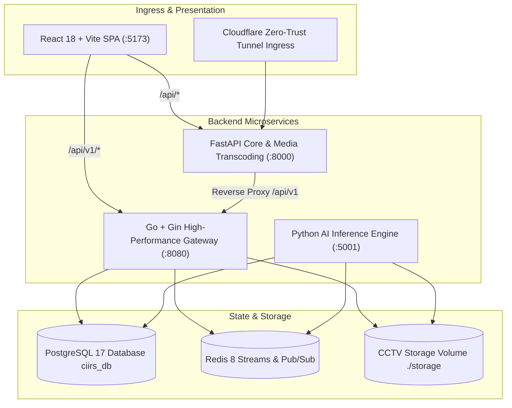

# CIIRS — CCTV Incident Intelligence & Reconstruction System

> **Team:** PANDA  
> **Hackathon:** Zinnovatio 4.0 – Gen Z Innovations Hackathon 2026  
> **Theme:** Smart & Sustainable Cities  
> **Core Principle:** Prevention-First Public Safety & Observational Activity Analysis (Zero demographic/biometric profiling)  
> **Repository:** `git@github.com:Pikasbrawl/CIIRS.git`

---

## 🌟 Overview

**CIIRS** (CCTV Incident Intelligence & Reconstruction System) is an enterprise-grade public safety command centre platform designed for smart city surveillance, multi-agency emergency coordination, and forensic incident reconstruction across Chandigarh.

It features a high-performance distributed microservice architecture combining Go + Gin, Python FastAPI, PyTorch AI acceleration (Apple Silicon MPS), PostgreSQL 17, Redis 8 Streams, and an interactive React 18 / TypeScript frontend.

---

## 🏛️ Key Capabilities

- **Institutional Three-Role Login Portal:** Professional, role-based landing page providing dedicated authentication and workflows for:
  1. *Public / Citizen Safety Portal*
  2. *Police / Operations Command Center*
  3. *Backend Systems Engineering & Telemetry*
- **Command Centre Dashboard:** Real-time surveillance grid, KPI ribbons, multi-camera live video feeds, spatial anomaly detection overlays, ANPR telemetry, and incident timelines.
- **Genuine GPS Chandigarh City Map:** OpenStreetMap street-level tile rendering, actual Chandigarh sector geography, Nominatim geocoding search, and real device GPS navigation tracking (`getCurrentPosition`, `watchPosition`).
- **Interactive ANPR & Vehicle Intelligence:** High-Security Registration Plate (HSRP) OCR inspection, real photographic vehicle imagery (Scorpio, Dzire, Classic 350, Honda City, i20, Innova Taxi), pending traffic challan lookups, and stolen vehicle watchlist tracking.
- **Citizen Incident Evidence System:** MediaDevices camera capture, multi-photo and video upload, live preview lightbox with thumbnail stripping, and GPS location tagging.
- **Multi-Camera Incident Reconstruction:** Synchronized 30-minute multi-angle temporal alignment, spatial trail tracking across city camera nodes, and SHA-256 evidence sealed reports.
- **Technical Backend Operations (Go + Gin):** Real-time service health checks, live latency measurements, 56 registered API routes dynamic registry, live PostgreSQL database telemetry across 13 core tables, storage capacity volume meters, Redis streams monitoring, and worker job retries.

---

## 🏗️ System Architecture



### Stack Components
- **Go Backend (`backend-go`):** Gin Web Framework, GORM ORM, `go-redis/v9`, dynamic route inspection, `syscall.Statfs` disk telemetry, running on `http://localhost:8080`.
- **Python Core (`backend`):** FastAPI (ASGI), SQLAlchemy, Uvicorn, background workers, JWT RBAC security, running on `http://localhost:8000`.
- **Python AI Engine (`ai-engine`):** PyTorch, Ultralytics YOLO11 / YOLOv8, ByteTrack multi-object tracking, OpenCV, Redis stream consumer, running on `http://localhost:5001`.
- **Database (`PostgreSQL 17`):** Primary database `ciirs_db` storing 13 relational tables (`cameras`, `videos`, `processing_jobs`, `detections`, `tracks`, `embeddings`, `events`, `incidents`, `incident_event_links`, `vehicle_detections`, `number_plate_detections`, `citizen_reports`, `reports`).
- **Queue & Streams (`Redis 8`):** Distributed event streaming via `ciirs:jobs:stream` and `ciirs:status:stream` with consumer groups and worker heartbeat keys.
- **Frontend (`frontend`):** React 18, TypeScript, Vite, Tailwind CSS, Lucide Icons, Recharts, Leaflet GIS.

---

## 🚀 Quick Start Guide

### Prerequisites
- Go 1.22+
- Python 3.11+
- Node.js 18+ & npm
- PostgreSQL 17 (listening on port 5432, database `ciirs_db`)
- Redis 7+ or 8 (listening on port 6379)

---

### 1. Go Backend Setup (`backend-go`)
```bash
cd backend-go
go build -o server ./cmd/server/main.go
./server
```
Runs on `http://localhost:8080`. Static CCTV storage is hosted at `/storage`.

---

### 2. Python AI Engine Microservice (`ai-engine`)
```bash
cd ai-engine
# Use the virtual environment with PyTorch and dependencies
PYTHONPATH=. ../backend/.venv/bin/python app/main.py
```
Runs on `http://localhost:5001` and connects to Redis stream `ciirs:jobs:stream`.

---

### 3. FastAPI Python Backend (`backend`)
```bash
cd backend
source .venv/bin/activate
uvicorn app.main:app --host 0.0.0.0 --port 8000 --reload
```
API documentation is available at `http://localhost:8000/docs`.

---

### 4. Frontend Setup (`frontend`)
```bash
cd frontend
npm install
npm run dev
```
Access the application at `http://localhost:5173`.

---

## 👥 Verified Demonstration Accounts

| Portal | Username | Password | Role | Description |
| :--- | :--- | :--- | :--- | :--- |
| **Public / Citizen Portal** | `citizen` | `citizen123` | `CITIZEN` | Resident Sector 17, community incident reporting and evidence upload |
| **Police / Operations** | `operator` | `operator123` | `OPERATOR` | 24/7 CCTV surveillance, automated event verification, ANPR tracking |
| **Police Responder** | `police_officer` | `police123` | `POLICE_RESPONDER` | Emergency coordination lead, unit dispatch, incident reconstruction |
| **Backend Systems Engineer** | `engineer` | `engineer123` | `ENGINEER` | System health diagnostics, PostgreSQL table inspection, storage & stream queues |

---

## 🛡️ Ethical AI & Privacy Compliance
CIIRS is built strictly around **observable scene-level activity indicators**. It does not perform facial recognition, demographic classification, biometric profiling, or predictive criminality scoring. All automated incident signals require human operator verification before official emergency response dispatch.
